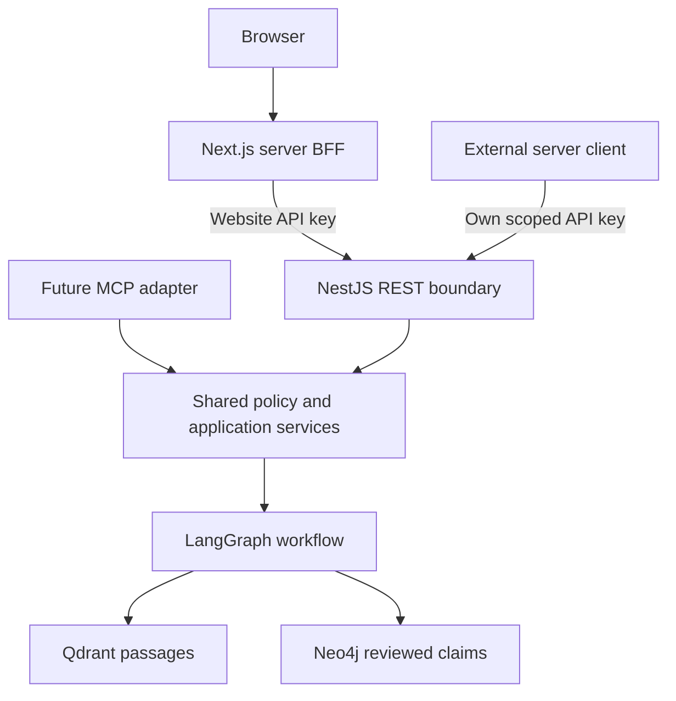

# Architecture and operations

## System boundary

Required direction: an API-first monorepo with a designated NestJS project (`apps/api`) and Next.js project (`apps/web`). Next.js server handlers are a thin backend-for-frontend, calling the versioned NestJS HTTP API with a dedicated server-only key. NestJS owns authentication, authorisation, quotas, LangChain integrations, LangGraph.js orchestration and retrieval through Qdrant and Neo4j. Python remains confined to offline Ragas evaluation initially. The applications deploy independently; no always-on server is required if both use Vercel Functions.

The [API-first decision record](decisions/001-api-first-nestjs.md) specifies TR01–TR07, REST contracts, credential lifecycle, external consumer access and the future MCP adapter. Next.js never holds database/model credentials or becomes the canonical location for backend business logic.

LangGraph's execution graph is distinct from the Neo4j knowledge graph: the former controls processing steps, the latter stores domain relationships. LangChain supplies reusable integrations rather than a competing orchestration loop. [R5]

## Online workflow

State carries a request ID, confirmed context, question, corpus version, retrieval mode, retrieved passages, accepted claim IDs, conflicts, evidence sufficiency, output and a budget ledger.

1. In NestJS, authenticate the consumer, authorise its scope, resolve the active release manifest once (recording the concrete Qdrant collection identifier and graph `corpus_version` in request state for every later step), take a concurrency lease and atomically reserve a conservative cost amount before paid work. Completion, abort, timeout and error paths all attempt to reconcile the reservation to actual usage; a lease that expires without a report frees only the concurrency slot, and the monetary reservation is settled conservatively at the reserved amount, exactly once, as ADR 001 specifies. Validate input and payload size; treat supplied text as data.

   The online workflow exposes no model-callable tools. The model produces only typed outputs (task classification, structured answer). Retrieval, graph lookup and the single recovery retrieval are deterministic nodes driven by validated state, never by model-emitted actions. Every citation ID in the output is validated against the assembled evidence bundle. This is the primary defence against instructions embedded in retrieved or uploaded text (SC20): such text can only influence answer content, which schema and prohibited-certainty checks then constrain.
2. Classify task with typed output. Use deterministic routes where possible.
3. If a missing field changes the route, return one clarification; do not start an unbounded conversational loop.
4. Retrieve dense/sparse passages with source type, jurisdiction, date and corpus filters. Starting candidates: top 20, fuse, rerank, keep up to 8 within a token budget. Tune using development data.
5. For dependency/relationship questions, resolve known entities and run a parameterised, allowlisted graph query. Maximum two hops and 30 returned claims initially. Graph evidence must resolve to original passage IDs.
6. Assemble evidence, compute currency for each passage and claim using the answer-time currency rule in the [data document](04-data-and-ontology.md#answer-time-currency-rule), detect conflicting assertions and mark unresolved questions. Deduplicate article excerpts and underlying sources so a derivative claim does not appear independently corroborated.
7. Generate structured action/compare/referral output using only the evidence bundle.
8. Validate schema, reference IDs, required dates and prohibited certainty. A citation existing is not proof it supports the claim; release evaluation separately checks entailment. Permit at most one bounded recovery retrieval if evidence is insufficient.
9. Return a typed answer, clarification or insufficient-evidence envelope. The website renders this contract as cards. JSON comes first; later streaming may emit progress states and a terminal validated result, never unvalidated regulatory claims as final content.

Apply the deadline across the BFF/API boundary and propagate cancellation. Set an initial 30-second application deadline with smaller per-service timeouts, cancellation and bounded retry. This is a design target, not a platform limit. Respect the selected Vercel runtime's current limits. [R6]

Cancellation mechanism: the BFF route handler observes the incoming request's abort signal (browser disconnect) and aborts its upstream `fetch` to NestJS; NestJS observes its own request close and the deadline, and passes a single `AbortSignal` into LangGraph (`config.signal`) and into every Qdrant, Neo4j and model call, each of which also has its own shorter timeout. An aborted or timed-out request reconciles its budget reservation like any other outcome; if it cannot (the function dies first), the reservation is settled conservatively rather than released. Whether a Vercel Function observes client disconnect promptly must be validated in slice 1B; until then, the concurrency lease and conservative settlement are the backstops.

## Persistence

MVP workflow: request-scoped state and explicit user-confirmed context on each turn. Authentication and quotas separately require a durable credential registry and atomic budget store before live activation; their failure denies new paid work. A browser-held draft can survive navigation with user control; do not claim server-side durable memory. Never use process memory as cross-request persistence on Vercel.

Offline ingestion: checkpointed job files keyed by content hash and schema version; resume from the last completed stage. Curator approval is recorded in reviewed files/PRs. If true online LangGraph interrupts or multi-session memory become required, choose a durable checkpointer and access-control model in a new decision record. Qdrant and the domain graph are not automatically LangGraph checkpoints.

## Offline ingestion and release

Manifest discovery → rights/fetch checks → immutable snapshot → text/table extraction → section-aware chunks → typed candidate claims → validation and review → versioned exports → shadow indexes → release validation → active version switch.

Every batch is idempotent. Stable IDs derive from source version, content position and extraction version. Source deletions and changed claims are tombstoned; reindexing cannot leave old current-status claims active. Publish an application release manifest only after both stores have the same validated corpus version. On partial promotion, retain the previous release. Keep the previous indexes until the new release has passed checks and capacity allows; otherwise rebuild during a disclosed maintenance window.

Release switching differs per store, and no combination of a Qdrant alias switch and a manifest update is atomic across both stores. Consistency is therefore enforced per request, not per switch:

- Each release manifest is immutable and names a concrete Qdrant collection (never an alias) plus a graph `corpus_version`. Qdrant aliases are a convenience for operators, not something the request path resolves.
- A request resolves the active manifest exactly once, at the start of step 1, and carries the collection identifier and `corpus_version` in its state through retrieval, graph lookup and the recovery retrieval. It never re-reads the active pointer mid-request.
- Neo4j AuraDB Free is a single database with no alias or blue/green facility, so a shadow graph lives in the same database: every reviewed claim, node and relationship carries `corpus_version`, and every allowlisted query is parameterised on the request's pinned version.
- Promotion writes the new manifest and then flips the active pointer. A request that started before the flip finishes on the old release; one that starts after uses the new one. Old collections and old-version graph data are retained for at least the maximum request deadline after the flip, and longer while capacity allows, so in-flight requests never lose their pinned release. Rollback flips the pointer back to the previous manifest, which is still present.
- Partial failure (new graph exported, new collection failed, or the reverse) never produces a manifest, so the pointer cannot move and no request can observe a mixed release.
- The response envelope reports the pinned `corpus_version`, so a mixed-release answer would be detectable in logs and tests.

This is how SC15 is enforced: a response can only cite evidence from the single manifest it resolved at its start.

Raw corpus storage is not the serverless filesystem. Start with rights-cleared local archives plus reproducible public-source fetch recipes; select durable private object storage before unattended ingestion. Public git holds manifests and safe fixtures, not arbitrary third-party full text. GitHub Actions is an optional manually triggered worker; private data must never leak through public job logs or downloadable artifacts.

## Hosting decision

| Component | Recommendation | Verified capacity / implication |
| --- | --- | --- |
| Qdrant Cloud Free | Hosted passage index | 1 GB RAM, 4 GB disk, single node, 0.5 vCPU. Inactivity suspension after one week and deletion after four weeks if not reactivated. [R2] |
| Neo4j AuraDB Free | Hosted property graph | 200,000 nodes, 400,000 relationships, 1 GB storage; no uptime SLA. [R3] |
| Aura inactivity | Operational recovery is required | Instance actions docs state auto-pause after 72 hours and deletion after over 30 days paused; verify the current console policy before launch. [R4] |
| Vercel Hobby | Separate Next.js and NestJS projects | Personal/non-commercial use; shared account limits still apply. NestJS runs as a Vercel Function. Check latency and streaming across both deployments. Ingestion and benchmark runs stay offline. Verified 5 November 2026: Hobby has no Spend Management; exceeding an included-usage limit pauses that feature for up to 30 days; runtime logs are retained for one hour and log drains are unavailable; preview deployments can require Vercel Authentication. Each website query consumes provisioned-memory time in two functions because the BFF waits on the API. [R6–R7, R21] |

### Expected paused states and restoration

For a personal deployment with sporadic traffic, paused free-tier stores are the normal state, not an incident. Verified limits (5 November 2026): Aura Free pauses after 72 hours of inactivity, does not resume automatically and is deleted after more than 30 days paused; a Qdrant free cluster is suspended after one idle week and deleted after four idle weeks unless reactivated. [R2, R4] Consequences the design must absorb:

- Distinguish three store states in capability reporting and failure handling: available, paused but recoverable (resume and retry once, otherwise degrade), and deleted (restore from versioned exports; the passage index rebuild re-incurs embedding cost).
- Keep a keep-alive check whose cadence is shorter than 72 hours for Aura and seven days for Qdrant. This may be a manually triggered job or an external scheduler; it is not assumed to be free, and it is not configured by this documentation.
- Store every release's versioned exports (passages, claims, manifests) outside both hosted stores so that a rebuild is deterministic. Rehearse the restore drill and record its cost before Stage 6.
- Write a per-request usage record (request ID, consumer, session hint, retrieval mode, tokens, estimated cost, outcome code) to the durable store, because platform logs on Hobby are gone after one hour. These records contain no prompt text.

Driver lifecycle on serverless: create Qdrant and Neo4j clients lazily as per-instance singletons, set explicit per-call timeouts, and check the provider's connection limits for the free tier at provisioning; the quota page checked for this review does not state a connection limit for Aura Free.

Neo4j is selected for a well-documented hosted free tier and explicit property-graph traversal. It is a pragmatic default, not an assertion that it is universally better than alternatives. Keep retrieval behind adapters so a future alternative can be compared without rewriting the UX.

Budget below the provider limits: initially at most 20,000 chunks, 10,000 entities/claims and 30,000 relationships. As a sizing example, 20,000 × 768 × 4-byte dense vectors occupy about 61.4 MB before payloads, indexes, sparse vectors and operational overhead. Actual dimension and storage must be measured; this arithmetic is not a capacity guarantee.

## Failure behaviour and cost controls

- Graph unavailable: use vector retrieval with a visible limitation; disable claims requiring missing graph evidence. Benchmark such a run as degraded, not a successful graph run.
- Vector retrieval unavailable: return a maintained source directory or clearly labelled static examples. Do not fabricate a live answer.
- Model timeout or daily budget reached: retain the user's draft and provide retry/static navigation. Do not keep charging through retries.
- Public live inference begins with provider-side spend controls on the model provider and a server-validated session/rate limit. Vercel Hobby offers no spend management, so the durable budget store in NestJS is the only platform-independent cap. If no durable quota mechanism is configured, deploy fixture mode only. In-memory counters are not a global spend cap; a development-mode in-process budget is acceptable only for slice 1A on a developer machine and must be labelled as such in the capabilities response.
- Per-visitor fairness on the website: all website traffic shares one consumer identity, so NestJS additionally enforces per-session sub-quotas within that consumer using the BFF-generated session hint defined in ADR 001. The BFF's own checks (payload size, request shape, simple burst limits) are best-effort; the API is authoritative.
- Keep credentials server-only. Separate query and ingestion credentials where provider roles allow; otherwise enforce read-only queries through the application boundary and document the residual privilege.
- No arbitrary model-written Cypher, browser-supplied query execution or model-controlled source fetching. Approved URL fetches need redirect, private-address, MIME, timeout and size checks.
- Logs record timings, token usage, source IDs and failure codes; omit raw private prompts/audio by default. Pin model IDs, embeddings, package locks, prompts, ontology and corpus versions in reports.

Model tokens, embeddings, transcription and X access may incur charges. Select a currency-specific monthly cap before enabling live services; estimate costs from corpus tokens, per-query tokens, judge calls and expected usage. A zero-cost fixture mode should remain available for contributors.
