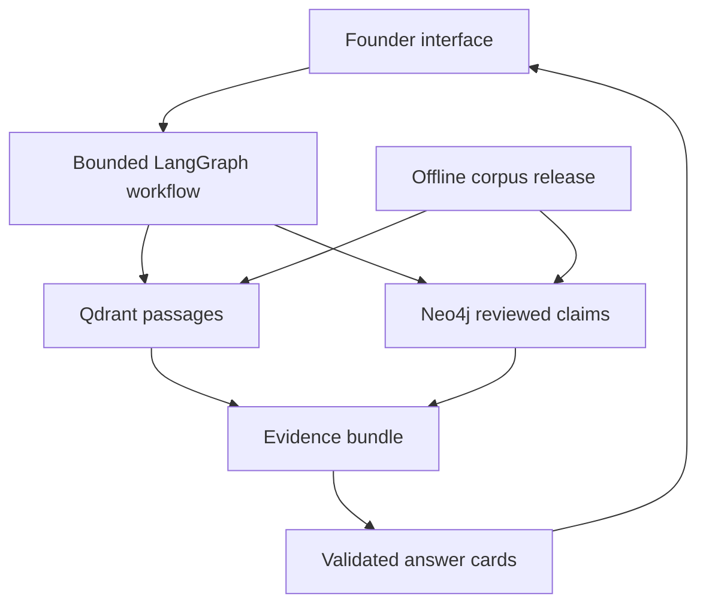

# Architecture and operations

## System boundary

Proposed online stack: Next.js with TypeScript and Node.js route handlers on Vercel; LangChain model, embedding and retrieval adapters; LangGraph.js for bounded orchestration; Qdrant for passages and Neo4j AuraDB for reviewed relationships. Python is confined to offline Ragas evaluation initially. No second always-on application server is required.

LangGraph's execution graph is distinct from the Neo4j knowledge graph: the former controls processing steps, the latter stores domain relationships. LangChain supplies reusable integrations rather than a competing orchestration loop. [R5]

## Online workflow

State carries a request ID, confirmed context, question, corpus version, retrieval mode, retrieved passages, accepted claim IDs, conflicts, evidence sufficiency, output and a budget ledger.

1. Validate input, payload size and request budget; treat supplied text as data.
2. Classify task with typed output. Use deterministic routes where possible.
3. If a missing field changes the route, return one clarification; do not start an unbounded conversational loop.
4. Retrieve dense/sparse passages with source type, jurisdiction, date and corpus filters. Starting candidates: top 20, fuse, rerank, keep up to 8 within a token budget. Tune using development data.
5. For dependency/relationship questions, resolve known entities and run a parameterised, allowlisted graph query. Maximum two hops and 30 returned claims initially. Graph evidence must resolve to original passage IDs.
6. Assemble evidence, detect stale/conflicting assertions and mark unresolved questions. Deduplicate article excerpts and underlying sources so a derivative claim does not appear independently corroborated.
7. Generate structured action/compare/referral output using only the evidence bundle.
8. Validate schema, reference IDs, required dates and prohibited certainty. A citation existing is not proof it supports the claim; release evaluation separately checks entailment. Permit at most one bounded recovery retrieval if evidence is insufficient.
9. Return validated cards or an honest partial answer. Stream progress states immediately; do not stream unvalidated regulatory claims as final content.

Set an initial 30-second application deadline with smaller per-service timeouts, cancellation and bounded retry. This is a design target, not a platform limit. Respect the selected Vercel runtime's current limits. [R6]

## Persistence

MVP: request-scoped state and explicit user-confirmed context on each turn. A browser-held draft can survive navigation with user control; do not claim server-side durable memory. Never use process memory as cross-request persistence on Vercel.

Offline ingestion: checkpointed job files keyed by content hash and schema version; resume from the last completed stage. Curator approval is recorded in reviewed files/PRs. If true online LangGraph interrupts or multi-session memory become required, choose a durable checkpointer and access-control model in a new decision record. Qdrant and the domain graph are not automatically LangGraph checkpoints.

## Offline ingestion and release

Manifest discovery → rights/fetch checks → immutable snapshot → text/table extraction → section-aware chunks → typed candidate claims → validation and review → versioned exports → shadow indexes → release validation → active version switch.

Every batch is idempotent. Stable IDs derive from source version, content position and extraction version. Source deletions and changed claims are tombstoned; reindexing cannot leave old current-status claims active. Publish an application release manifest only after both stores have the same validated corpus version. On partial promotion, retain the previous release. Keep the previous indexes until the new release has passed checks and capacity allows; otherwise rebuild during a disclosed maintenance window.

Raw corpus storage is not the serverless filesystem. Start with rights-cleared local archives plus reproducible public-source fetch recipes; select durable private object storage before unattended ingestion. Public git holds manifests and safe fixtures, not arbitrary third-party full text. GitHub Actions is an optional manually triggered worker; private data must never leak through public job logs or downloadable artifacts.

## Hosting decision

| Component | Recommendation | Verified capacity / implication |
| --- | --- | --- |
| Qdrant Cloud Free | Hosted passage index | 1 GB RAM, 4 GB disk, single node, 0.5 vCPU. Inactivity suspension after one week and deletion after four weeks if not reactivated. [R2] |
| Neo4j AuraDB Free | Hosted property graph | 200,000 nodes, 400,000 relationships, 1 GB storage; no uptime SLA. [R3] |
| Aura inactivity | Operational recovery is required | Instance actions docs state auto-pause after 72 hours and deletion after over 30 days paused; verify the current console policy before launch. [R4] |
| Vercel Hobby | Non-commercial personal demo | Free tier is restricted to personal/non-commercial use. Ingestion and benchmark runs stay offline. [R6–R7] |

Neo4j is selected for a well-documented hosted free tier and explicit property-graph traversal. It is a pragmatic default, not an assertion that it is universally better than alternatives. Keep retrieval behind adapters so a future alternative can be compared without rewriting the UX.

Budget below the provider limits: initially at most 20,000 chunks, 10,000 entities/claims and 30,000 relationships. As a sizing example, 20,000 × 768 × 4-byte dense vectors occupy about 61.4 MB before payloads, indexes, sparse vectors and operational overhead. Actual dimension and storage must be measured; this arithmetic is not a capacity guarantee.

## Failure behaviour and cost controls

- Graph unavailable: use vector retrieval with a visible limitation; disable claims requiring missing graph evidence. Benchmark such a run as degraded, not a successful graph run.
- Vector retrieval unavailable: return a maintained source directory or clearly labelled static examples. Do not fabricate a live answer.
- Model timeout or daily budget reached: retain the user's draft and provide retry/static navigation. Do not keep charging through retries.
- Public live inference begins with provider-side spend controls and a server-validated session/rate limit. If no durable quota mechanism is configured, deploy fixture mode only. In-memory counters are not a global spend cap.
- Keep credentials server-only. Separate query and ingestion credentials where provider roles allow; otherwise enforce read-only queries through the application boundary and document the residual privilege.
- No arbitrary model-written Cypher, browser-supplied query execution or model-controlled source fetching. Approved URL fetches need redirect, private-address, MIME, timeout and size checks.
- Logs record timings, token usage, source IDs and failure codes; omit raw private prompts/audio by default. Pin model IDs, embeddings, package locks, prompts, ontology and corpus versions in reports.

Model tokens, embeddings, transcription and X access may incur charges. Select a currency-specific monthly cap before enabling live services; estimate costs from corpus tokens, per-query tokens, judge calls and expected usage. A zero-cost fixture mode should remain available for contributors.
