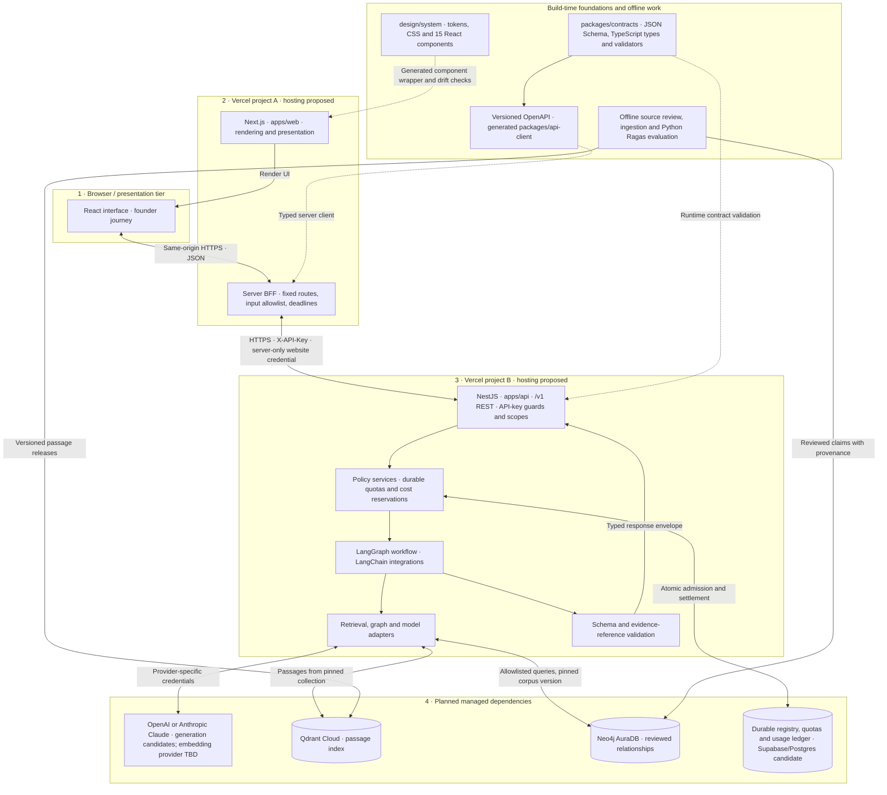

# Oz Startup Brain — technology and tier architecture

**Queensland pilot · 7 November 2026 · target live architecture**

This view shows deployment boundaries, the BFF pattern, credentials, shared contracts, the design system and managed dependencies. Current applications run locally with fictional fixtures. Managed hosting, live models, retrieval and durable operational storage remain planned.

## Mermaid source

Solid arrows show target runtime traffic. Dotted arrows show build-time dependencies. A runtime arrow does not imply a service is live today.

## Technology choices and supporting relationships

| Area | Technology and role | Status |
|---|---|---|
| Presentation | Next.js and React in apps/web render the founder journey and typed response cards. | Fixture implementation |
| Design system | Custom design/system tokens, CSS and 15 React components. Generated wrappers let Next.js consume the committed components; drift checks keep them aligned. Examples include EvidenceLabel, StatusNotice and PrerequisiteMap. | Implemented foundation |
| Web hosting | Vercel project A hosts the Next.js app and server handlers. | Proposed deployment |
| BFF boundary | A server-only typed client forwards allowed inputs to fixed NestJS endpoints using the website API key. Browser receives no upstream secrets. | Fixture implementation; live operational controls still gated |
| Backend | NestJS in apps/api owns API-key guards, scopes, validation, policy and response contracts. One modular application contains the backend logic. | Fixture implementation; live services planned |
| API hosting | Vercel project B gives the backend an independent deployment boundary. This adds a network hop and environment/credential coordination. | Proposed deployment |
| Contracts | packages/contracts provides JSON Schema, generated TypeScript and Ajv validators. OpenAPI and packages/api-client keep clients compatible with the API. | Implemented foundation |
| AI execution | LangGraph controls the bounded workflow. LangChain supplies integrations behind backend adapters. | Planned live path |
| Generation | OpenAI or Anthropic Claude can implement the generation adapter. No production provider or model is fixed here, and this does not imply both are called or automatic failover exists. | Candidate providers |
| Embeddings | A separately selected embedding implementation supports consistent ingestion and retrieval. A generation model choice does not automatically select embeddings. | Provider pending |
| Passages | Qdrant Cloud supports passage retrieval with corpus and metadata filtering. | Selected in design; live service pending |
| Relationships | Neo4j AuraDB stores reviewed dependencies and prerequisites with original-passage provenance. | Selected in design; live service pending |
| Operational state | Durable credential registry, atomic quotas/cost reservations and a usage ledger are required across serverless instances. | Required before live paid work |
| Supabase/Postgres | Possible implementation of operational persistence, based on the service named in this request. Needs a decision and validated atomic admission/settlement. It does not replace Qdrant or Neo4j in the current design. | Candidate; not an approved dependency |
| Offline quality | Source review, versioned ingestion, Python Ragas and scenario evaluations support corpus releases outside the user request. | Live pipeline planned; fixture testing is separate |

## Request and security walkthrough

1. The founder uses React components served by Next.js. Shared tokens and components keep layout, themes and evidence vocabulary consistent.
2. Browser requests go to same-origin Next.js BFF endpoints. The browser never receives the website API key or model/database credentials.
3. The BFF forwards allowed business fields to an allowlisted NestJS origin using HTTPS and X-API-Key. It strips untrusted identity headers and is not a general-purpose proxy.
4. NestJS verifies the key and its scopes. This key identifies the website application, not the founder. Accounts or private saved journeys require separate user authentication and ownership checks.
5. Before paid live work, durable consumer/session/global limits and atomic cost reservation admit each request. Anonymous session hints support fairness, not identity or ownership.
6. NestJS pins one corpus release, orchestrates retrieval and calls the selected model through adapters. Online model/database credentials belong only in the API. Offline ingestion uses separate write credentials where supported.
7. NestJS validates the typed output and evidence references. The BFF returns the envelope and the web app renders action cards, sources, dates, limitations or clarification.

A hidden API key alone does not protect a public BFF from abuse. Durable limits are required before live inference. CORS is not authentication. Rotation and revocation belong to the API policy layer. Citation-ID validation alone does not establish that a source supports a claim.

## Design-time versus runtime

Claude Design is the authoring origin of the committed design-system export. Its components are wrapped and consumed by Next.js; Claude Design is not a runtime website dependency.

Anthropic Claude in the service tier is a possible live generation provider. This differs from Claude helping build code or the design system. Likewise, developer use of OpenAI/Codex does not establish OpenAI as a deployed provider.

The inspected architecture does not establish Supabase Auth, Supabase Storage, Vercel AI Gateway, Tailwind or shadcn as required dependencies. They have not been silently added.

## Why the choices fit together

- Design tokens and reusable React components provide one reviewed visual language.
- Next.js handles rendering and the BFF while upstream credentials remain server-only.
- NestJS centralises policy and AI behavior so later consumers can reuse the backend.
- Shared schemas and a generated client reduce contract drift between independently deployed applications.
- Vercel functions need durable shared state for credentials and spending limits. Process-local counters cannot enforce global budgets.
- Model adapters isolate provider-specific behavior from orchestration, while each provider still needs capability tests.
- Qdrant finds source passages; Neo4j adds reviewed relationships. A request pins both to one corpus release.

## One-minute talk track

“We separate presentation from application policy and AI behavior. The Next.js web app reuses our design system and calls a thin server BFF. The BFF holds the website API key and talks to a separate NestJS API, with both apps intended to deploy as separate Vercel projects. NestJS owns scopes, spending controls and the LangGraph workflow. It accesses Qdrant for passages, Neo4j for reviewed relationships, and a model through provider adapters. Shared schemas and a generated client keep the two apps compatible. Supabase is a possible home for durable operational state, while OpenAI and Claude are provider options. The working build is still fixture-based.”

## Evidence

Inspected repository files on 7 November 2026 (Australia/Sydney):

- [API-first decision](https://github.com/nissan/oz-startup-brain/blob/main/docs/decisions/001-api-first-nestjs.md)
- [Architecture and operations](https://github.com/nissan/oz-startup-brain/blob/main/docs/03-architecture.md)
- [Provider boundaries](https://github.com/nissan/oz-startup-brain/blob/main/docs/decisions/002-decision-models.md)
- [Web dependencies](https://github.com/nissan/oz-startup-brain/blob/main/apps/web/package.json)
- [API dependencies](https://github.com/nissan/oz-startup-brain/blob/main/apps/api/package.json)
- [Contract package](https://github.com/nissan/oz-startup-brain/blob/main/packages/contracts/package.json)
- [API client package](https://github.com/nissan/oz-startup-brain/blob/main/packages/api-client/package.json)
- [Design-system generation](https://github.com/nissan/oz-startup-brain/blob/main/apps/web/scripts/sync-design-system.mjs)
- [Design tokens](https://github.com/nissan/oz-startup-brain/blob/main/design/system/tokens.json)
- [Design handoff](https://github.com/nissan/oz-startup-brain/blob/main/design/system/HANDOFF.md)

The handoff retains older wording that the application does not consume components. The current generation script and web dependencies establish consumption; this diagram follows the implementation evidence.